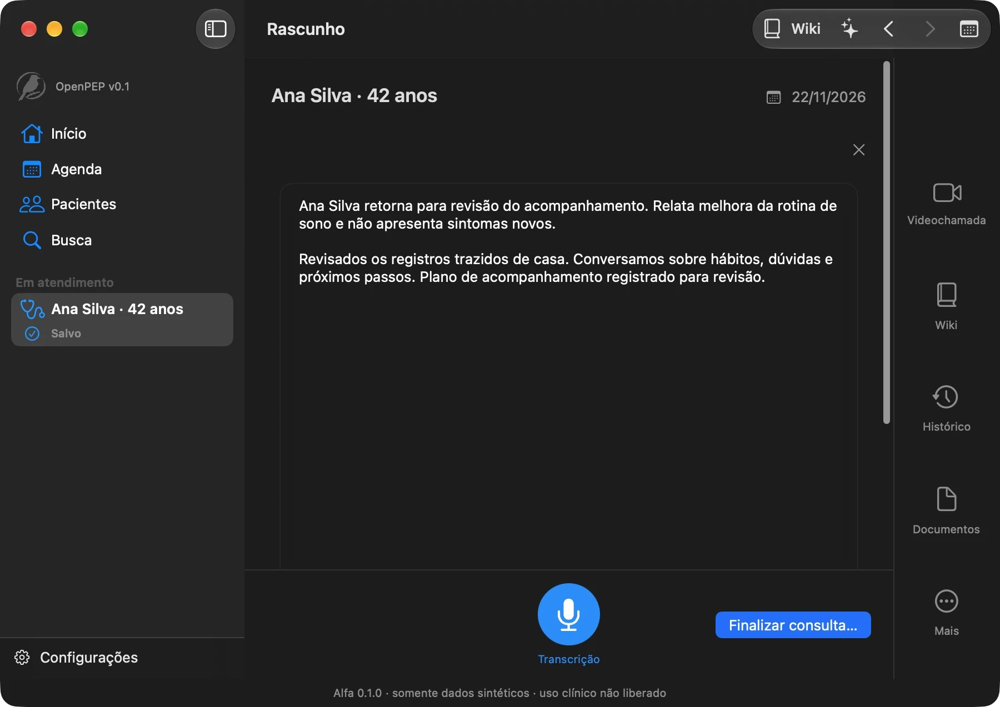

<!-- SPDX-License-Identifier: CC-BY-4.0 -->

# OpenPEP

<p align="center">
  
</p>

**Boas tecnologias desaparecem na paisagem.**

Um prontuário ambulatorial brasileiro de código aberto, com transcrição, inteligência artificial e registros em arquivos locais. Feito para que o profissional conduza a consulta, revise o que a IA propõe e mantenha o controle do prontuário.

[Conheça o OpenPEP e assista ao filme](https://openpep.com.br)



**Alfa experimental `0.1.0-alpha.1`, sem liberação para uso clínico.** Use somente dados sintéticos. Ainda não há instalador público; o DMG assinado e notarizado está em preparação.

## O que já está no aplicativo

- **Voz e IA na consulta:** transcrição local ou pela OpenAI, resumo revisável e assistente contextual. Serviços externos são opcionais e exigem autorização; recursos locais dependem da disponibilidade no Mac.
- **Prontuário legível:** notas em Markdown, metadados YAML, anexos locais e visão IPS com fontes e revisão profissional. PDFs, imagens e textos podem ser importados para o paciente.
- **Agenda e Google Meet:** agenda local e criação de salas do Meet após conectar uma conta Google. Na alfa, a conexão requer importar um JSON OAuth de aplicativo Desktop; as instruções estão nas configurações. A chamada abre no navegador.
- **Receitas e documentos:** composição e geração local de PDFs, integração com o SNCR para numeração e assinatura com certificado disponível no Mac. Homologação é o padrão do SNCR; produção exige escolha explícita e autorização própria.
- **Controle dos registros:** rascunhos com salvamento automático, finalização com autenticação do Mac, correções por adendo, exportação, backup e restauração em uma nova pasta.

## Experimente

Compile o aplicativo e escolha **Explorar demonstração**, ou crie um prontuário em uma pasta vazia. A configuração rápida orienta a chave OpenAI, o teste da conexão e a permissão do microfone. Também é possível continuar localmente. Novos áudios ficam em `recordings/`, dentro do prontuário.

O alvo inicial é **Mac com Apple Silicon e macOS 26 ou posterior**. A validação recente ocorreu no macOS 27. Windows, sincronização entre dispositivos e recepção web não fazem parte desta alfa.

## Desenvolvimento

Aplicativo nativo em SwiftUI. A pasta do prontuário é a fonte dos registros, sem servidor ou banco de dados obrigatório. Schemas TypeScript e `vaultctl` validam a estrutura da pasta independentemente do aplicativo; ainda não verificam o registro de auditoria gravado por ele. Os modelos PDF são renderizados localmente em WebKit.

Use Xcode 27, Swift 6.4, a versão de Node definida em `.node-version` e REUSE:

```sh
brew bundle
make bootstrap
make mac-bootstrap
make check
make mac-check
```

Abra `apps/macos/OpenPEP.xcodeproj` no Xcode, selecione **OpenPEP → My Mac** e execute com `⌘R`. Configure a assinatura de desenvolvimento localmente, sem versionar credenciais. `make mac-check` compila e testa sem assinatura de código.

O site está em `website/`: execute `npm ci --prefix website` e `npm run build --prefix website` para compilar o Tailwind. A página é estática; sirva essa pasta por HTTP.

## OpenPEP-Rx

O repositório também inclui o [módulo independente de prescrição](apps/openpep-rx/README.md), com interface no navegador, serviço local, SQLite e assinatura via VIDaaS Connect. Ele tem instalação própria e não substitui o aplicativo nativo.

## Limites

A IA produz propostas que exigem revisão. O registro de auditoria guarda o hash de cada nota final ao lado dela, sem encadeamento nem assinatura. Ele detecta alterações acidentais, mas quem pode escrever na pasta consegue alterar a nota e o registro juntos sem que o aplicativo perceba. Proteção contra adulteração deliberada ainda não existe. A assinatura atual verifica integridade CMS, mas não valida conformidade ICP-Brasil/PAdES ou revogação. O catálogo CID-10 DATASUS V2008 é histórico e segue os termos descritos em [LICENSING.md](LICENSING.md#catálogo-cid-10-de-terceiros).

Antes da distribuição, faltam a revisão final da candidata, repetir a finalização com senha após a correção do crash e validar o instalador em outro Mac. Notarização Apple não representa validação clínica. Veja o [aviso de saúde](DISCLAIMER-SAUDE.md).

## Colabore

O projeto está aberto a contribuições de diferentes especialidades e profissões da saúde. Ajude a testar com dados sintéticos, melhorar os fluxos ou adaptar o código. Para contribuir, siga [CONTRIBUTING.md](CONTRIBUTING.md); para falhas de segurança, consulte [SECURITY.md](SECURITY.md).

Aplicativo e site sob **AGPL-3.0-or-later**; schemas e ferramentas sob **Apache-2.0**. Catálogos, marca e mídia têm termos próprios em [LICENSING.md](LICENSING.md). Essas licenças não dão ao projeto direitos sobre os prontuários de quem usa o software.
